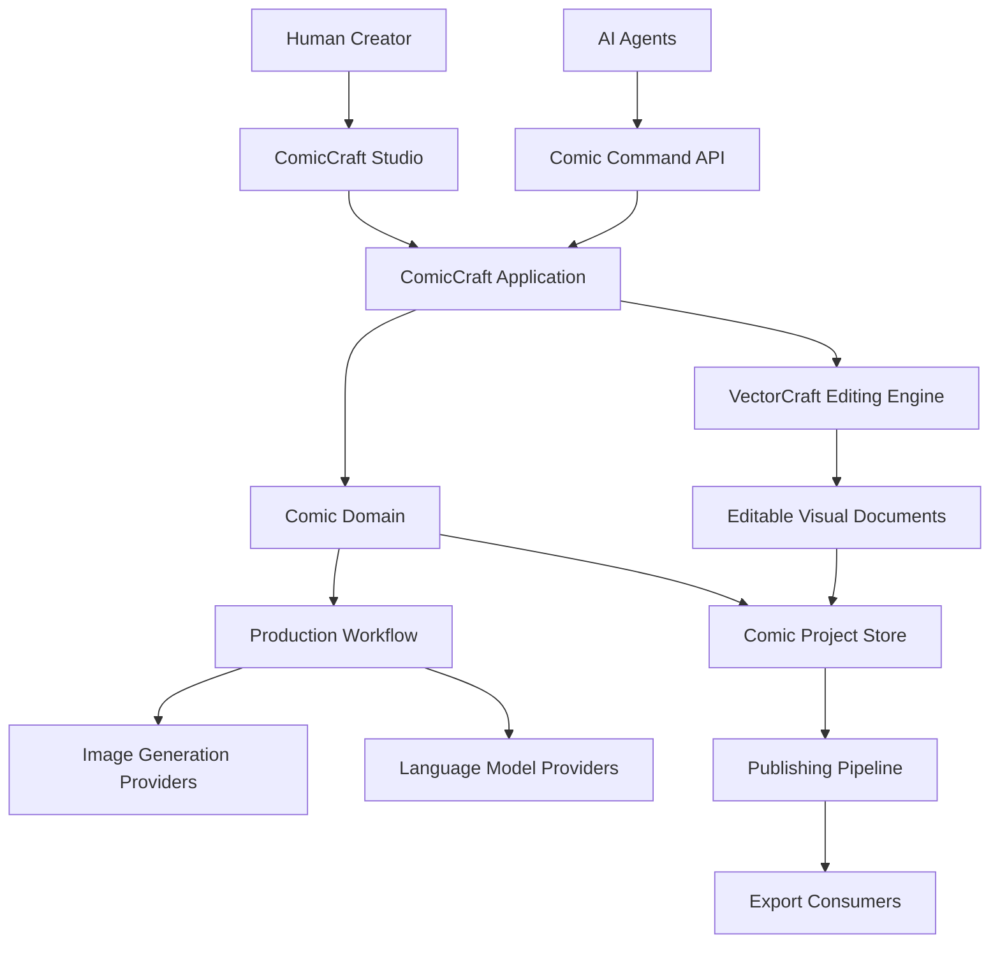
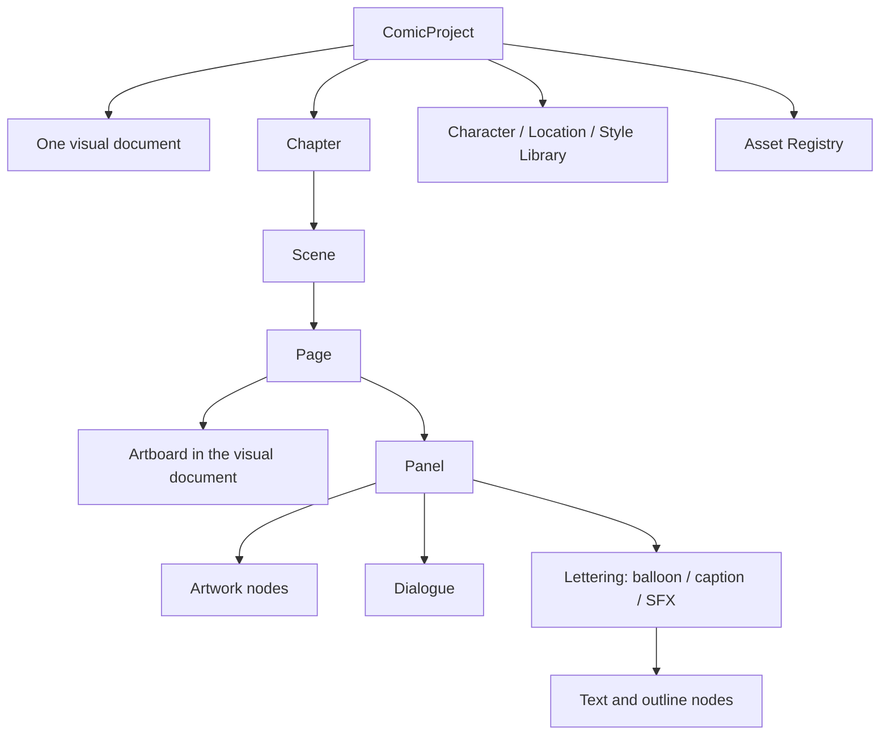
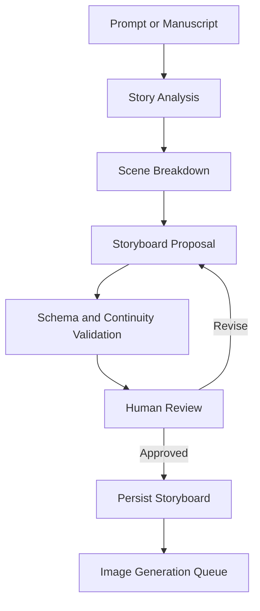
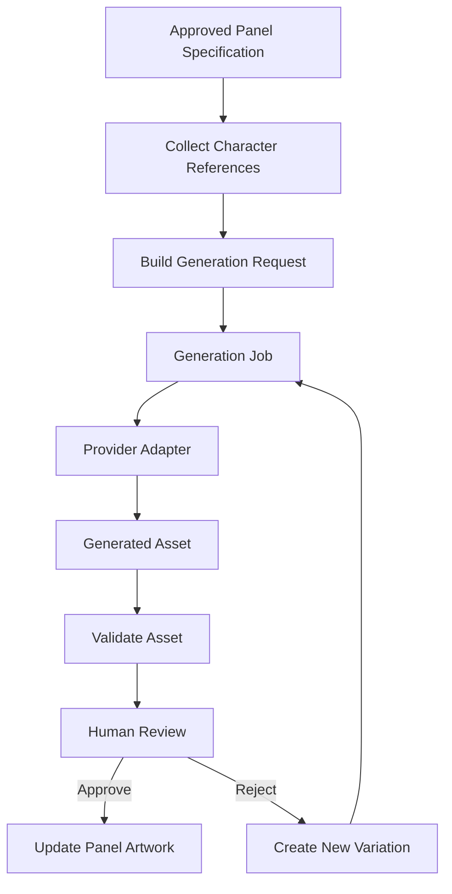
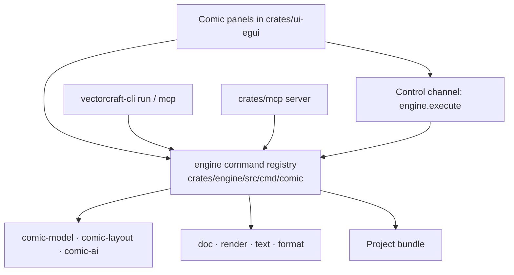

# ComicCraft
## System Architecture Design

**Document type:** Software Architecture Design (SAD)
**Status:** Finalized (v1.0) — implementation-ready
**Foundation:** VectorCraft 0.8.0 — `storytold/vectorcraft` @ `3da4080b`
**Product:** Agent-native AI comic creation and editing studio
**Companions:** [`comiccraft-porting-plan.md`](comiccraft-porting-plan.md) · [`comiccraft-porting-audit.md`](comiccraft-porting-audit.md)

> **How to read this document.** Sections 1–15 state the design. Section 4 no longer
> proposes code boundaries: it maps ComicCraft onto the real crates and the real layer
> rules. Sections 16–18 record the finalized decisions, the acceptance criteria and the
> first assignment. Sections 19–20 record what is verified to exist and what is still
> an open risk. Every API named here was read from the baseline revision and is cited
> in the audit; no API in this document is invented or assumed.

---

# 1. Architectural vision

ComicCraft is a story-to-comic production system built by extending VectorCraft's existing vector editing engine.

The system must support a complete workflow:

**Prompt / Story → AI Story Editor → Storyboard → AI Artwork Generation → Comic Page Composition → Human Editing → Rendering → Publishing**

The architecture must satisfy five principles:

1. **Preserve the foundation:** reuse VectorCraft's existing geometry, document, text, rendering, history, file-format and automation infrastructure.
2. **Semantic editing:** stories, characters, panels, balloons and captions are first-class domain entities, not objects inferred from layer names.
3. **Editable AI output:** generated images, text, layout and graphic elements remain independently editable.
4. **Agent-human parity:** agents and human users operate on the same project through consistent editing semantics.
5. **Incremental implementation:** the first usable product must work before all AI services and advanced workflows are implemented.

## 1.1 Non-goals

The initial architecture does not attempt to:

- Build a new vector graphics engine.
- Train a proprietary image-generation model.
- Replace every existing VectorCraft capability.
- Automatically produce publication-quality comics without human review.
- Support real-time collaborative editing in the first release.
- Require a cloud backend for ordinary local editing.

---

# 2. System context



The system has two distinct forms of state:

- **Comic semantic state:** story structure, character identity, narrative order, panel relationships, dialogue, asset provenance and workflow status.
- **Visual document state:** paths, placed images, text objects, transforms, masks, clipping and rendered composition.

The architecture must preserve the relationship between these two forms without making either a lossy substitute for the other.

---

# 3. Logical architecture

The application is divided into six logical subsystems.

## 3.1 Presentation subsystem

Responsibilities:

- Story and chapter navigation.
- Storyboard and page thumbnail views.
- Comic page canvas.
- Panel and balloon editing.
- Character and asset library.
- AI generation controls.
- Validation results and publishing UI.

The presentation layer must not contain authoritative story or project logic.

It issues application commands and renders application state.

The existing VectorCraft canvas and editing interactions should be reused wherever practical.

## 3.2 Application subsystem

The application layer coordinates use cases across the comic domain and the editing engine.

Responsibilities:

- Create and open projects.
- Create, modify and delete comic entities.
- Coordinate semantic and visual changes.
- Execute undoable editing operations.
- Submit and monitor generation jobs.
- Validate project changes.
- Save and export projects.

Application use cases must be callable from the GUI, CLI and agent interfaces.

A single use case must not have different business semantics depending on which interface invokes it.

## 3.3 Comic domain subsystem

This subsystem defines the core concepts and rules of comic production.

Primary entities:

- ComicProject
- Chapter
- Scene
- Character
- Location
- StyleProfile
- Page
- Panel
- Dialogue
- Lettering — one entity covering balloons, captions and sound effects
- Asset
- GenerationJob
- ReviewDecision

Responsibilities include stable identity, narrative ordering, relationship
validation, character continuity constraints and project-level invariants.

The earlier draft listed `Balloon`, `Caption` and `SoundEffect` as three unrelated
entities while §5.2 defined only `Balloon`. Their difference is presentation, not
structure, so they are one `Lettering` entity with a `kind` discriminant; §5.2 gives
the schemas and §5.2.1 the link ownership.

The domain model must not depend directly on GUI components or external AI providers.

## 3.4 Visual editing subsystem

This subsystem adapts VectorCraft's existing engine to comic-specific editing.

Reuse existing capabilities for:

- Geometry and transformations.
- Vector paths and shapes.
- Text layout.
- Raster image placement.
- Layers and groups.
- Clipping and compositing.
- Undo/redo.
- Document serialization.
- Rendering and export.

Add comic-specific operations where needed:

- Create and edit panel frames.
- Attach artwork to panels.
- Create balloons and tails.
- Fit dialogue into balloons.
- Create captions and sound effects.
- Apply page templates.
- Preserve semantic links between comic entities and visual objects.

The adapter must use verified VectorCraft APIs. Do not assume that every required operation already exists.

## 3.5 AI and workflow subsystem

This subsystem coordinates non-deterministic operations.

Components:

- Story analysis service.
- Storyboard planning service.
- Character reference service.
- Image-generation adapters.
- Image-editing adapters.
- Continuity checking.
- Dialogue and lettering assistance.
- Generation queue and job tracking.

AI output must be validated against structured schemas before entering authoritative project state.

A generated suggestion must remain a proposal until accepted by the applicable workflow.

## 3.6 Persistence and publishing subsystem

Responsibilities:

- Versioned project storage.
- Asset management.
- Schema migration.
- Generation provenance.
- Save/reopen consistency.
- Render queue.
- PDF and image export.
- Export validation.

The system must support local-first editing and must not require an online AI provider to reopen or edit an existing project.

---

# 4. Code boundaries — reconciled with the workspace

The earlier draft of this section listed placeholder names and deferred them to a
repository audit. That audit is now done
([`comiccraft-porting-audit.md`](comiccraft-porting-audit.md) §3): the boundaries
below are the actual crates, the actual layer numbers
(`xtask/src/layers.rs:9-57`), and the three new crates ComicCraft adds.

### 4.1 Existing crates ComicCraft builds on

| Layer | Crate | Role for ComicCraft |
|---|---|---|
| L0 | `geom`, `color` | panels, gutters, page geometry, colour |
| L1 | `doc` | the visual document: artboards, layers, objects, images, text, masks |
| L2 | `text` | balloon and caption typesetting, wrapping, overflow, shrink-to-fit |
| L2 | `effects` | live non-destructive art and lettering effects |
| L2 | `pathops` | panel shape booleans, balloons, tails |
| L2 | `brush`, `trace`, `plugins` | ink, tracing generated art, sandboxed effects |
| L3 | `render` | page and panel rendering, thumbnails, raster export |
| L3 | `pdf` | print output: one page per artboard, trim, bleed, marks |
| L3 | `svg` | vector interchange for pages and panels |
| L3 | `format` | the native `.vectorcraft` document format |
| L4 | `tools` | pointer tool state machines (panel, balloon, tail tools) |
| L5 | `engine` | **the command registry** — sessions, history, undo |
| L6 | `ui-egui` | the thin egui front end, panels and dock |
| L6 | `mcp` | MCP server: `tools/list`, `command_list`, resources |
| — | `testkit` | golden-render comparison, dev-dependency only |

### 4.2 New crates

Three new crates, not twelve. Each takes the lowest layer that satisfies its
dependencies; the exact intra-layer orderings are declared in `INTRA_LAYER_ORDER`
(`xtask/src/layers.rs:65-84`) as part of adding them.

| Crate | Layer | Depends on | Responsibility |
|---|---|---|---|
| `crates/comic-model` | L2 | `doc`, `geom`, serde | Project bundle schema, stable comic ids, narrative entities, page/panel records, lettering records, asset provenance records, schema migrations, and the bundle reader/writer. No network, no AI, no UI. |
| `crates/comic-ai` | L3 | `comic-model`, an HTTP transport (feature-gated) | Provider-neutral generation interfaces: capability descriptors, request building, job state machine, response validation. No knowledge of `doc`, `render` or the UI. |
| `crates/comic-layout` | L4 | `comic-model`, `doc`, `geom`, `text`, `render`, `pdf`, `svg` | Deterministic page and panel layout, templates, gutters, reading order, balloon fitting and overflow policy, validation rules, page/book export assembly. |

The layers are chosen so that **every dependency points downward and no same-layer edge
exists** — comic-`model` sits above `doc`, comic-`ai` above `comic-model`, and
comic-`layout` at L4 above the renderers and exporters it assembles. That matters
because `cargo xtask layers` permits a same-layer dependency only when the pair is
listed in `INTRA_LAYER_ORDER` (`xtask/src/layers.rs:65-84`), and each such pair is a
hand-maintained entry. This placement needs none.

What the layers buy, concretely: `comic-model` and `comic-ai` cannot reach `engine`,
`ui-egui` or `mcp`; `comic-layout` cannot either, even though it orchestrates rendering
and export. Comic logic is therefore testable headlessly, which is what makes the CLI
and MCP paths real rather than aspirational.

Two further surfaces are **added to existing crates** rather than forked into new
ones, for reasons the baseline forces:

- **Commands go in `crates/engine`.** `command_specs()` is a fixed concatenation
  inside the engine crate and there is no external registration hook
  (`crates/engine/src/cmd/mod.rs:85-132`). Comic commands are therefore additive
  modules — `crates/engine/src/cmd/comic/*.rs`, each contributing `specs()` — so
  that the GUI, the control channel, the CLI and MCP all reach them through the one
  path everything else uses (`Session::execute`,
  `crates/engine/src/lib.rs:1071-1095`). This is a deliberate, documented divergence
  from upstream and is recorded as ADR-014.
- **Comic panels go in `crates/ui-egui`.** egui/eframe are permitted only at L6
  (`xtask/src/layers.rs:9-11`, `xtask/src/layers.rs:88-90`), and a separate UI crate
  would need a same-layer edge to `ui-egui`. The comic workspace is therefore a
  panel family inside the existing front end (`crates/ui-egui/src/panels/comic/`),
  registered through `UI_COMMANDS`
  (`crates/ui-egui/src/menus.rs:1-20`), reading engine state and acting only through
  `app.run(id, params)`. The logic it displays lives in the comic crates (L2–L4), not
  in the panel code.

### 4.3 Two structural rules

1. **Visual documents stay pure VectorCraft.** No comic field is added to
   `crates/doc` or to `crates/format`. A page's visual document is a plain
   `.vectorcraft` file that opens in VectorCraft itself, which keeps the fork thin
   and upstream merges cheap. Comic metadata lives beside it and refers to it by id
   (ADR-012, ADR-013).
2. **No comic crate depends on the command layer or the UI.** `comic-model`,
   `comic-ai` and `comic-layout` must not depend on `engine` (L5), `ui-egui` (L6) or
   `mcp` (L6). The dependency arrow points one way: `engine` calls comic logic, never
   the reverse. That is what keeps the deterministic core testable headlessly and lets
   the same crates serve the desktop UI, the CLI and MCP.

```text
Presentation      L6  ui-egui (comic panels) · mcp
                       │
Application       L5  engine (comic command modules)   ← sessions, history, undo
                       │
Assembly          L4  comic-layout · tools
                       │
Renderers         L3  comic-ai · render · pdf · svg · format
                       │
Domain            L2  comic-model · text · effects · pathops · brush · trace · plugins
                       │
Visual document   L1  doc          (artboards = pages, Node = visual object)
                       │
Foundations       L0  geom · color
```

Do not introduce a crate for every concept merely to match a diagram. If a
responsibility fits naturally in one of the three crates, put it there.

---

# 5. Canonical domain model

## 5.1 Project hierarchy



A scene may span multiple pages. A page may contain multiple panels. A panel may
contain multiple dialogue entries and artwork references.

Do not force one scene to equal one page, or one dialogue entry to equal one lettering
object.

### 5.1.1 A page is an artboard, not a separate document

**Decision (ADR-011): one comic project is one visual document, and each page is one
artboard in it.**

The baseline forces this, for four independent reasons:

1. **History is per document.** `DocState` owns its own `History`, `Session::edit`
   touches only the active document, and the undo group is per `DocState`
   (`crates/engine/src/lib.rs:83-133`, `crates/engine/src/lib.rs:955-1007`,
   `crates/engine/src/lib.rs:1346-1374`). With one document per page, an operation
   that spans pages — reordering pages, applying a template to a chapter, a batch
   regeneration — could not be a single undo step, and the design's own §11.2
   requirement would be unmet. There is no cross-document transaction layer to build
   on.
2. **Print output already maps pages to artboards.** PDF export writes one page per
   artboard, with the trim box equal to the artboard, the bleed box grown by the
   bleed, and the media box including marks (`crates/pdf/src/lib.rs:1-20`,
   `crates/pdf/src/export.rs:33`). A chapter export is then an `artboards` selection,
   not a document-assembly step.
3. **Per-page export already exists.** `Renderer::render_region` renders an artboard
   rect (`crates/render/src/lib.rs:611`), `Renderer::render_thumbnail(doc, NodeId,
   size)` renders an object for a storyboard (`crates/render/src/lib.rs:634`), and
   web export can clip to one artboard
   (`crates/engine/src/cmd/webexport.rs:547-556`).
4. **Artboard identity is serialized.** `Artboard { id: u32, name, rect, .. }`
   (`crates/doc/src/lib.rs:340-348`), with `artboard.new`, `artboard.setProps`,
   `artboard.delete` and `artboard.reorder` already available
   (`crates/engine/src/cmd/layer.rs:124-143`, `crates/engine/src/cmd/panelcmds.rs:56-67`).

**Rejected: one document per page.** It gives each page its own history, its own
`revision` and its own file, which is easy to reason about in isolation — but it
breaks single-step undo across pages, multiplies the files that must stay consistent,
and duplicates page size between the artboard and the comic `Page` record. It also
discards the artboard navigator and per-artboard export that already work.

**Consequences of the accepted decision**, all of which are enforced in the sections
that follow:

- `Page` carries `artboard_id: u32`; it does **not** carry `page_size` or a
  `visual_document_id`. The artboard rect in points is the page size, and it has one
  owner (§6.1).
- Bleed, trim and marks are **export settings**, not page fields: they live in
  `PdfSettings` (`crates/pdf/src/lib.rs:17-20`), and `Artboard` has no such fields
  (`crates/doc/src/lib.rs:340-348`).
- Pages are ordered by an explicit comic `reading_order`, never by artboard position
  on the canvas. Artboard order in the document is presentation, not narrative.

## 5.2 Core entities

These are the finalized entity set. They are `serde` types in `crates/comic-model`,
serialized as JSON in the project bundle (§7). The previous draft listed a subset of
what §3.3 promised and carried two contradictory fields; both are fixed here.

| Entity | Purpose |
|---|---|
| `ComicProject` | project root: title, settings, libraries, the visual document reference |
| `Chapter` | book-level division |
| `Scene` | narrative unit that may span several pages |
| `Character` | identity, approved design version, continuity rules |
| `Location` | reusable setting |
| `StyleProfile` | visual-style constraints for generation and lettering |
| `Page` | narrative page — one artboard |
| `Panel` | a shot inside a page: frame, artwork, reading position |
| `Dialogue` | what is said, and who says it |
| `Lettering` | how it is presented: balloon, caption or sound effect |
| `Asset` | an imported or generated file, with provenance |
| `GenerationJob` | one asynchronous provider request |
| `ReviewDecision` | an approval or rejection, with actor and time |

### ComicProject

- `id: ComicId`
- `schema_version: u32`
- `title: String`
- `metadata` — author, language, genre, reading direction (`ltr` | `rtl`), created, updated
- `chapter_ids: Vec<ChapterId>`
- `character_ids: Vec<CharacterId>`
- `location_ids: Vec<LocationId>`
- `style_profile_ids: Vec<StyleProfileId>`
- `asset_registry_id: AssetRegistryId`
- `settings: ProjectSettings` — default page size, default template, default lettering style
- `visual_document: VisualDocumentRef { relative_path, format_version }` — **one** document for the whole project (ADR-011)

### Chapter

`id`, `project_id`, `title`, `scene_ids`, `order_index`.

### Scene

`id`, `chapter_id`, `title`, `synopsis`, `page_ids`, `location_id?`,
`character_ids`, `order_index`, `continuity_notes`.

### Page

- `id: PageId`
- `chapter_id: ChapterId`
- `scene_ids: Vec<SceneId>`
- `artboard_id: u32` — **the page's visual home; replaces the earlier `visual_document_id`**
- `page_number: u32` — the printed folio
- `panel_ids: Vec<PanelId>`
- `reading_order: Vec<PanelId>`
- `status: PageStatus` — `draft` | `generated` | `lettered` | `approved` | `published`

**Removed from this entity, with their new owner:** `page_size` (the artboard's `rect`
is authoritative, §6.1) and `bleed_and_trim_settings` (PDF export settings —
`PdfSettings` carries `bleed` and `marks`, `crates/pdf/src/lib.rs:17-20`).

### Panel

- `id: PanelId`
- `page_id: PageId`
- `artboard_id: u32`
- `scene_id: SceneId`
- `frame_node_id: NodeId` — the panel frame object in the visual document
- `artwork_refs: Vec<ArtworkRef>` — `ArtworkRef { asset_id: AssetId, node_id: NodeId, role: Primary | Background | Overlay }`
- `shot_description: String` — the generation brief
- `dialogue_ids: Vec<DialogueId>`
- `lettering_ids: Vec<LetteringId>`
- `reading_order_index: u16`
- `continuity_constraints` — characters present, wardrobe, time of day, callbacks
- `generation_status: GenerationStatus`

**Removed:** `geometry_ref`. Panel geometry is not duplicated in the comic model; the
frame object in the visual document owns it, and the panel reaches it by
`frame_node_id` (§6.1). The earlier draft's `geometry_ref` invited exactly the
two-authoritative-copies problem §6.1 forbids.

### Dialogue

- `id: DialogueId`
- `panel_id: PanelId`
- `speaker_character_id: Option<CharacterId>` — `None` for narration
- `text: String`
- `language: Option<String>`
- `reading_order_index: u16`
- `approval_status: ApprovalStatus`

**Removed:** `balloon_id`. The draft had `Dialogue.balloon_id` and
`Balloon.dialogue_id`, which is two owners for one relationship. `Lettering.dialogue_id`
is now the single authoritative link (§6.1).

### Lettering

One entity covers balloons, captions and sound effects, because their difference is
presentation, not structure.

- `id: LetteringId`
- `page_id: PageId`, `panel_id: PanelId`, `artboard_id: u32`
- `kind: LetteringKind` — `Speech` | `Thought` | `Narration` | `Shout` | `Whisper` | `SoundEffect`
- `dialogue_id: Option<DialogueId>` — required for `Speech`, `Thought`, `Shout`, `Whisper`
- `text: Option<String>` — the payload for `Narration` and `SoundEffect`
- `frame_node_id: NodeId` — the balloon outline or caption box
- `tail_node_id: Option<NodeId>` — the tail path, when the kind has one
- `text_node_id: NodeId` — the area text object inside the frame
- `text_layout_settings` — font, size, leading, tracking, alignment, padding, `fit_to_frame`
- `overflow_policy: OverflowPolicy` — `Warn` | `Shrink` | `ResizeFrame`

### Character

- `id: CharacterId`, `name: String`, `canonical_description: String`
- `reference_asset_ids: Vec<AssetId>`
- `style_profile_id: Option<StyleProfileId>`
- `approved_design_version: Option<AssetId>` — immutable reference, never rewritten in place
- `continuity_rules` — invariants that generation prompts must carry

### Location, StyleProfile

`Location { id, name, description, reference_asset_ids }`.
`StyleProfile { id, name, description, palette, line_weight, rendering_notes }`.

### Asset

- `id: AssetId`, `asset_type: AssetType` — `Source` | `Generated` | `Edited` | `Reference`
- `storage_reference: StorageRef` — project-relative path, or an embedded key in the visual document
- `content_hash: ContentHash { algorithm, value }`
- `media_metadata` — mime, pixel dimensions, colour profile, dpi
- `provenance: Provenance` — provider, model, prompt, parameters, input asset ids, timestamp
- `parent_asset_ids: Vec<AssetId>` — the generation or edit this derived from
- `approval_status: ApprovalStatus`

### GenerationJob

- `id: JobId`, `operation: JobOperation`
- `target_panel_id: Option<PanelId>`, `input_asset_ids: Vec<AssetId>`
- `provider: ProviderId`, `model: String`, `request` — the exact request, for provenance
- `status: JobStatus` — `queued` | `running` | `completed` | `failed` | `awaiting_review` | `cancelled`
- `progress: Option<Progress>`, `error: Option<JobError>`
- `result_asset_ids: Vec<AssetId>`
- `created`, `updated`
- `target_revision: u64` — the `DocState.revision` the request was built against (§11.3)

### ReviewDecision

- `id: ReviewDecisionId`
- `subject: ReviewSubject` — panel artwork, story content, character design, batch edit, publication
- `decision: Decision` — `approved` | `rejected` | `superseded`
- `actor: String`, `timestamp`, `note: Option<String>`
- `superseded_asset_id: Option<AssetId>` — the artwork that was replaced, retained

### 5.2.1 Link ownership

One side owns each relationship. The other side is found by lookup, never stored twice.

| Relationship | Owner | Target identity |
|---|---|---|
| Page ↔ artboard | `Page.artboard_id` | `Artboard.id: u32` |
| Page → panels | `Page.panel_ids` | `PanelId` |
| Panel → frame object | `Panel.frame_node_id` | `NodeId(u64)` |
| Panel → artwork objects | `Panel.artwork_refs[].node_id` | `NodeId(u64)` |
| Lettering → dialogue | `Lettering.dialogue_id` | `DialogueId` |
| Lettering → outline / tail / text objects | `Lettering.frame_node_id`, `.tail_node_id`, `.text_node_id` | `NodeId(u64)` |
| Dialogue → speaker | `Dialogue.speaker_character_id` | `CharacterId` |
| Asset → parent assets | `Asset.parent_asset_ids` | `AssetId` |
| Job → result assets | `GenerationJob.result_asset_ids` | `AssetId` |

Field names are final in this document. Optionality, integer widths and the exact
wire format are fixed by `docs/comiccraft-project-schema.md` in M0, which must not
contradict this section.

## 5.3 Stable identity

Every persistent entity has a stable identifier, and the two visual identities are
taken from the engine rather than invented.

**Comic entities** use their own newtypes over `u64` in `crates/comic-model`
(`ComicId`, `ChapterId`, `SceneId`, `CharacterId`, `PanelId`, `DialogueId`,
`LetteringId`, `AssetId`, `JobId`). They are allocated from a persisted counter in
the project manifest, so they survive save/reopen, reordering and regeneration.

**Visual objects** are identified by `NodeId(pub u64)` — *"Stable per-document object
id. Never reused."* — which is serialized transparently and never reassigned
(`crates/doc/src/node.rs:19-20`). `Document` keeps `next_id` and repairs the counter
after loading foreign data with `fix_next_id()`
(`crates/doc/src/lib.rs:580-745`, `crates/doc/src/lib.rs:736-745`).

**Pages** are identified by the comic `PageId`; the artboard is reached through
`Page.artboard_id`. Changing a panel's position must not change its identity.
Replacing its artwork must not invalidate its dialogue references. Reordering pages
must not rewrite character IDs. Visual object references must remain valid across
save/reopen.

Never use array indices as persistent identifiers.

### 5.3.1 The artboard-id hazard

`Artboard.id` is **not** allocated the way `NodeId` is. `Document::next_artboard_id()`
returns `max(id) + 1` (`crates/doc/src/lib.rs:1028-1030`), and there is no
`fix_next_id()` equivalent for artboards. Deleting the highest-id artboard therefore
lets the next `artboard.new` reuse that id, and a `Page.artboard_id` left over from
the deleted page would silently resolve to a different page.

Five mitigations are mandatory, because silent page-identity drift is exactly the
class of bug this architecture exists to prevent (the schema states the same five, rule 4 and
rule 17):

1. **Comic commands own artboard lifecycle.** `comic.page.create`,
   `comic.page.delete` and `comic.page.reorder` are the only supported ways to add,
   remove or move a page's artboard while a project is open, so the comic model is
   updated in the same undoable operation. `artboard.delete` is not offered in the
   comic workspace.
2. **Retired ids are remembered.** The project manifest keeps `retired_artboard_ids`, and a
   page that resolves to a retired id is reported as broken, not trusted.
3. **Validation cross-checks.** `comic.project.validate` verifies that every
   `Page.artboard_id` exists and is not retired, and **reports** the artboard's `rect`
   as information. It checks no size expectation, because the artboard *is* the page's
   size and no field holds a second copy to compare against (schema §5.1, rule 15). A
   missing or retired artboard is surfaced as a repairable inconsistency (§6.3), never
   auto-corrected.
4. **The comic layer never reuses a retired id.** Because `max(id) + 1` can hand back a
   retired number, `comic.page.create` must **reject an artboard whose id is already retired**
   and allocate until it gets a fresh one — otherwise deleting a page would permanently break
   the next page to reuse that number, and rules 4 and 17 would leave it unfixable (schema
   rule 17).
5. **Fix it upstream.** Propose the small upstream change that allocates artboard ids
   from a persisted counter, as `NodeId` already does
   ([`comiccraft-porting-audit.md`](comiccraft-porting-audit.md) §13 U1). Until it
   lands, mitigations 1–4 stand on their own; 5 would remove the cause, not replace the guards.

---

# 6. Ownership and synchronization

The most important architectural boundary is between semantic entities and visual objects.

## 6.1 Ownership rules

| Information | Authoritative owner |
|---|---|
| Story text and scene structure | Comic domain |
| Character identity and approved references | Comic domain |
| Panel narrative order and reading order | Comic domain |
| Page identity and page folio | Comic domain (`PageId`, `page_number`) |
| Page size | Visual document — the artboard's `rect`, in points |
| Panel visual geometry and frame shape | Visual document, reached by `Panel.frame_node_id` |
| Panel artwork pixels and placement | Visual document, reached by `ArtworkRef.node_id` |
| Lettering outline and tail geometry | Visual document, reached by `Lettering.frame_node_id` / `.tail_node_id` |
| Dialogue text and speaker identity | Comic domain |
| Lettering text and typography | Comic domain — the linked text node is a rendering of it |
| Bleed, trim and printer's marks | Export settings (`PdfSettings`), never the page |
| Comic project metadata | Comic domain, stored beside the visual document |
| Rendered page pixels | Render pipeline output |
| Generated image history and provenance | Asset/provenance subsystem |

Avoid storing two independently editable authoritative copies of panel geometry,
dialogue, or page size. For example, the dialogue entity owns the text, while its
linked visual text object owns the rendered placement and typography. The visual object
must not silently become a second source of dialogue truth.

**Three rules make this enforceable rather than aspirational:**

1. **Every cross-model link points one way — from the comic model into the visual
   document.** No comic field is added to `crates/doc` and no comic section is added to
   `crates/format` (ADR-013). §5.2.1 names the owning side of every relationship.
2. **A visual document never stores comic meaning.** It stays a plain `.vectorcraft`
   file that opens in VectorCraft itself. Anything a comic reader needs must be
   reachable from `crates/comic-model` by `NodeId` or `artboard_id`.
3. **Deleting or renaming a visual object is never allowed to invent comic content.**
   When a link dangles, the application reports it and offers repair (§6.3).

`Node.name` is used for human-facing labels only. It is never parsed, and never used
as an identity: it is not unique, not validated, and a user can change it freely.

## 6.2 Synchronization operations

All cross-model changes should pass through application commands.

Example: changing a balloon's text.

1. Resolve the balloon and linked dialogue.
2. Validate the new text.
3. Update the semantic dialogue.
4. Recompute text layout in the linked visual object.
5. Check for overflow.
6. Commit the changes as one logical undoable operation.
7. Return validation results to the caller.

If the operation fails, do not leave half of the update committed.

## 6.3 External document edits

The visual editor may permit low-level edits that do not originate from comic commands.

For example, a user might delete a text object directly.

The application must detect unresolved semantic references and provide a clear repair path. It must not silently invent replacement dialogue or delete semantic records.

Use explicit reconciliation tools for invalid or missing links.

---

# 7. Document and project persistence

## 7.1 Project bundle

**Decision (ADR-012): the working project is a directory bundle, not a single
archive.** A single-file container is defined later as an *export* (§7.5), sharing
the same manifest schema.

```text
example.comiccraft/                     # directory bundle
├── manifest.json                       # bundle id, comic schema_version, id counters,
│                                       #   retired_artboard_ids, document reference
├── project.json                        # ComicProject
├── story/
│   ├── chapters.json
│   ├── scenes.json
│   ├── characters.json
│   ├── locations.json
│   └── styles.json
├── pages/
│   └── page-003.json                   # Page + Panels + Dialogue + Lettering
├── document/
│   └── comic.vectorcraft               # the ONE visual document (artboards = pages)
├── assets/
│   ├── references/  panels/  backgrounds/  lettering/
│   └── index.json                      # the Asset registry
├── provenance/
│   └── generations.json                # GenerationJobs and ReviewDecisions
├── jobs/                               # durable metadata for in-flight jobs
└── exports/                            # output only; deletable, never authoritative
```

**Why a bundle rather than one file.** The visual document is already a single file
in a format with its own version and its own migration path
(`crates/format/src/lib.rs:49-60`, `crates/format/src/lib.rs:161-168`); a comic
archive would mean a second container format to design, version, fuzz and migrate.
The workspace has `flate2` but no archive dependency, so a single-file container is
also the only part of this design that would need a new third-party dependency before
anything works. A bundle keeps provenance, exports and large assets out of the
document, keeps `git diff` usable during development, and lets the asset directory be
replaced or synced independently. The cost — several files that must stay mutually
consistent — is handled by §7.2.

**How the two formats relate.** The visual document uses VectorCraft's native format
unchanged, so `document/comic.vectorcraft` opens in VectorCraft itself and in any
other tool that reads it. The comic schema is versioned independently in
`manifest.json` and never touches `crates/format`. The two versions move
independently: a newer VectorCraft can raise `format::VERSION` and migrate the
document inside a bundle whose comic schema version is unchanged.

The per-page comic file is keyed by `Page.id` rather than by a file ordinal, so
renaming or renumbering a page never has to move a file. `Page.artboard_id` is what
binds that file to the document.

## 7.2 Transactional save

The project must not become corrupt if the application closes during a save. The
bundle is written in this order. Steps 4 and 5 are both observable, and the gap between them is
the one window a load must tolerate (schema §14):

1. Serialize every changed comic file into `<bundle>/.save-tmp/`.
2. Save the visual document through the native format writer (`crates/format`) into
   the same staging directory. This is what handles the appended blob section for
   embedded images.
3. Verify the staged document by loading it back
   (`format::load_file` rejects an unknown `format` and any `version > VERSION`,
   `crates/format/src/lib.rs:438-442`).
4. **Replace the content files** — every file except the manifest — with atomic per-file
   renames. The manifest still describes the previous generation, so a reader that trusts it
   (as it must: it is the only file that declares the bundle's contents) still sees the
   previous one.
5. **Write `manifest.json` last**, with the new generation counter and content hashes, then
   discard the staging directory.

Because the manifest is the last thing written and is the only file that declares
what the bundle contains, it can never reference partially written data. A crash
before step 5 leaves the previous manifest, and therefore the previous consistent
project, intact. A crash *between* steps 4 and 5 leaves content files that are newer
than the manifest says, which is why a `files`/tree mismatch is a **reported
inconsistency and not a fatal load error** (schema §14) — the window is survivable
rather than locking the creator out. On Windows, where
replacing a directory is not atomic, per-file replacement plus the manifest ordering
gives the same guarantee at the granularity that matters.

Embedded images live inside the visual document's blob section
(`crates/format/src/lib.rs:1-14`, `crates/format/src/lib.rs:69-98`); project assets
live in `assets/` and are content-addressed, so an interrupted save cannot overwrite
an approved asset — it writes a new file with a new hash.

## 7.3 Migrations

Every persisted schema has an identifiable version: `manifest.schema_version` for the
bundle, and `format::File.version` for the visual document
(`crates/format/src/lib.rs:161-168`).

The comic schema migrates in `crates/comic-model`, following the shape the engine
already uses: `format::load_file` runs `drop_edit_modes`, `migrate_overprint_black`,
`migrate_color_profiles`, `fix_next_id` and `tidy_saved_selections` after parsing
(`crates/format/src/lib.rs:451-461`). A comic migration must:

- Validate its input and refuse rather than guess.
- Preserve every stable id, including `retired_artboard_ids`.
- Report incompatible data as a visible, actionable error.
- Never silently discard unsupported fields — unknown comic fields are preserved so a
  newer ComicCraft can read a project an older one saved.
- Ship with a fixture from every previous version, tested in CI.

`crates/format` behaviour is not changed by ComicCraft. If a migration is needed for
the document itself, it is an upstream change and gets an upstream test.

## 7.4 Asset storage and integrity

**Artwork is linked, not embedded, by default.** A panel's artwork is an `ImageObject`
whose `link: LinkInfo` names a file under `assets/`, and the document keeps only a
low-resolution preview, so it still draws when a file cannot be read. This keeps the
visual document small — the single largest scalability risk (R4) — and lets one asset
serve several panels without duplication. Embedding remains available per asset for
portability, and `File ▸ Package Project` (§7.5) embeds everything so an exported
archive is self-contained. Validation resolves every link and reports a missing or
changed file.

**Two hashes, two jobs.** `LinkInfo.hash` is FNV-1a 64-bit
(`crates/doc/src/links.rs:76-79`). It answers "has this file changed since I last read
it", which is exactly what the engine uses it for, and it is *not* collision-resistant.
`Asset.content_hash` is SHA-256: `sha2` is already a direct dependency of `crates/pdf`
(`crates/pdf/Cargo.toml:34`), so this needs a workspace dependency entry rather than a
new crate, and it is what integrity and provenance rely on.

Keep the original generated asset when creating edited derivatives:
`Asset.parent_asset_ids` records lineage, and regeneration must never overwrite the only
copy of an approved image. `GenerationJob.target_revision` and
`ReviewDecision.superseded_asset_id` make "what was replaced" recoverable rather than
lost (§9.4).

---

## 7.5 Single-file export

A later phase adds `File ▸ Package Project`, producing one `.comiccraft` archive that
contains the same bundle (manifest, project, story, pages, document, assets) with the
same manifest schema plus an `archive_version`. This is an **export**, not the working
format: opening one unpacks it to a directory.

It is deferred because it is the only part of this design that needs a container
implementation, and the workspace has `flate2` but no archive library. It must be
deterministic (stable entry order and timestamps) so that packaging the same project
twice produces identical bytes, which is also what makes it testable.

---

# 8. Comic layout engine

The layout engine converts semantic panel and lettering data into a visual composition.
It is deterministic code in `crates/comic-layout`: it computes a plan and returns it, it
never invents narrative content, and it never calls back into the engine. The engine's
comic command modules apply that plan to the document, which is what makes the result
one undoable operation (§11.2).

## 8.1 Page layout

Inputs:

- The page artboard's `rect` (this is the page size — see §5.1.1).
- Margin and gutter settings.
- Panel count.
- Desired layout template.
- Reading direction (`ltr` | `rtl`).
- Panel importance or intended emphasis.
- Optional fixed panel geometry.

Outputs:

- The artboard `rect`, when the template sets the page size.
- One panel frame object per panel, as an ordinary path or group in the visual
  document.
- Gutter dimensions.
- `Panel.reading_order_index` and `Page.reading_order`.
- Validation warnings.

Panel geometry ends up **as document objects**: the plan names a rectangle per panel,
the command creates the frame object, and the comic model only ever holds
`Panel.frame_node_id` (§6.1). The layout engine never keeps a second copy of a
rectangle it computed.

Start with deterministic grid and template layouts. Introduce AI-assisted layout
suggestions only after the deterministic engine works. AI can propose a layout, but
the deterministic validator must still check overlap, gutter width, minimum panel
size, safe margins and reading order before anything is written.

## 8.2 Panel artwork

Each panel supports one primary artwork object plus optional background and overlay
objects, all listed in `Panel.artwork_refs` with their roles. The baseline already
provides every mechanism this needs:

| Need | Mechanism | Citation |
|---|---|---|
| Place artwork in a panel | `ImageObject { key, width, height, xf, link, placement }` | `crates/doc/src/node.rs:381-395` |
| Clip artwork to the panel | clip group (`Group.clip`), `Path.clipping`, opacity mask, or the renderer's `area: Option<&(BezPath, FillRule)>` | `crates/doc/src/node.rs:404-417`, `crates/render/src/lib.rs:1493-1530` |
| Crop artwork | `object.cropImage` — crop to a rect, or trim to the non-transparent pixels | `crates/engine/src/cmd/menucmds.rs:110-116` |
| Crop interactively | the clip-a-rectangle-around-the-image command, which selects the clipping path so dragging its handles crops | `crates/engine/src/cmd/menucmds.rs:118-123` |
| Border | a stroke on the frame object, or a live effect | `crates/doc/src/node.rs:496-540` |
| Replacement history | `ArtworkRef.node_id` changes; the previous `Asset` is retained and recorded by `ReviewDecision.superseded_asset_id` | §5.2 |
| Non-destructive art finishing | live `Effect` records in the appearance stack | `crates/effects/src/lib.rs:1-25` |

## 8.3 Lettering

Speech balloons, captions and sound effects are `Lettering` records (§5.2) whose
presentation is an editable vector outline plus an editable text object. The
typography layer the previous draft assumed would have to be written already exists:

| Need | Mechanism | Citation |
|---|---|---|
| Text inside a balloon frame | `TextKind::Area { frame }` | `crates/doc/src/text.rs:862-915` |
| Wrapping and alignment | `text::layout_with(db, &TextObject, &LayoutOptions)` | `crates/text/src/layout.rs:194` |
| Padding and inset | `LayoutOptions::inset` | `crates/text/src/lib.rs:46-64` |
| Overflow detection | `TextLayout.overflow`, `TextLayout.bounds` | `crates/text/src/lib.rs:159-183` |
| Shrink or scale to fit | `LayoutOptions::fit` → `shrink_to_fit`, reported as `TextLayout.fit_scale` | `crates/text/src/layout.rs:194-211` |
| Auto-resize the balloon to the text | `TextLayout.bounds` in the balloon's text space, then resize the frame path | `crates/text/src/lib.rs:167-172` |
| Type on a curved tail | `TextKind::OnPath`, `TextLayout.on_path` | `crates/doc/src/text.rs:862-915` |
| Caret and hit-testing for direct editing | `caret_position`, `hit_byte` | `crates/text/src/lib.rs:274`, `crates/text/src/lib.rs:294` |

`Lettering.overflow_policy` decides what happens when text does not fit: `Warn` reports
it, `Shrink` uses the shrink-to-fit path, `ResizeFrame` grows the frame. Automatic
resizing must never move unrelated page elements; growing a frame that would collide
with another panel or lettering object is reported, not applied.

**Lettering faces are not available in the repository.** The bundled fonts are Inter,
JetBrains Mono, Source Sans 3 and Source Serif 4 — UI and body text
(`crates/text/build.rs:1-16`, `assets/fonts/`). Comic lettering and sound-effect faces
belong in `storytold/craft-fonts`, never in this repository (`AGENTS.md:31`), so this
is a dependency on a companion repository, not on a design change. Everything must
build, run and pass tests with `CRAFT_FONTS` empty, and a project whose lettering font
is missing must surface exactly the missing-font report the exporter already produces.

**Resolved (ADR-017).** The two faces are now in `craft-fonts`, both OFL-1.1 and used
unmodified:

| Face | Styles | For |
|---|---|---|
| **Comic Neue** | Regular, Bold, Italic | dialogue, captions and narration — designed for comic lettering legibility |
| **Bangers** | Regular | display: sound effects, titles and cover text |

They are pinned to `google/fonts` commits with their SHA-256 and licence files, exactly like
the Japanese, Chinese and Arabic faces already there, and `craft-fonts`'s own tests
(`every_file_matches_its_manifest_checksum`, `every_font_ships_its_licence`,
`every_font_is_the_family_the_manifest_says`) cover them. ComicCraft names them as **defaults**
in `ProjectSettings.default_lettering_style` (schema §5.3) rather than hard-coding them, so a
project can choose different faces and a build without `CRAFT_FONTS_DIR` still works — the
lettering then falls back with a missing-font report rather than failing to render.

---

# 9. AI production architecture

AI services must operate as external, replaceable adapters.
l
## 9.1 Story pipeline



AI-generated story structures are proposals until validated and accepted.

The story service should return structured data with stable IDs or explicit ID-mapping instructions, not just prose.

## 9.2 Image generation pipeline



Generation jobs should be asynchronous.

The editor must remain usable while jobs run. A failed request must not corrupt the existing project or remove approved artwork.

## 9.3 Provider abstraction

Define capability-based interfaces rather than assuming all image models provide the
same features. `comic-ai` describes a provider by what it can actually do, and every
request is built from that descriptor:

- Text-to-image.
- Reference-conditioned generation.
- Image-to-image.
- Inpainting.
- Variations.
- Job status and cancellation.

Record the actual provider, model and request parameters used for every generation in
`GenerationJob.request` and `Asset.provenance`. A result that cannot be traced to a
request is not acceptable.

**No HTTP client crate appears anywhere in `Cargo.lock`, direct or transitive**
([`comiccraft-porting-audit.md`](comiccraft-porting-audit.md) §12.4). Adding one is
a deliberate, gate-visible decision (ADR-015):

- It must be MIT/Apache-2.0 or equivalent and must survive the repository's
  dependency and asset rules.
- It must not break `cargo xtask wasm`. Provider calls are therefore behind a feature
  that is **off** for the wasm build, and `comic-ai` must compile to a
  capability-empty stub there (`xtask/src/main.rs:175-205` runs the wasm gate).
- It must not be reachable from `crates/doc` or `crates/format`: the visual document
  and its format stay offline and deterministic.
- Credentials live in user configuration outside the project bundle, are never
  serialized into `manifest.json`, `project.json` or a job record, and are never
  included in an exported package.
- Sending user artwork to a provider requires explicit configuration and informed
  consent, and the consent recorded for a job is part of its provenance.

Providers are only required for generation. Editing, validating, saving, reopening
and exporting an existing project must work with no provider configured at all.

## 9.4 Human approval

Use approval gates for:

- Replacing approved artwork.
- Changing accepted story content.
- Changing character design references.
- Applying batch edits to multiple pages.
- Publishing final output.

Routine, reversible layout edits may execute directly within the user's established
editing workflow.

A gate is a state, not a dialog. A completed job holds `result_asset_ids` and stays
`awaiting_review` until a `ReviewDecision` approves or rejects it; approving applies
the result through ordinary commands in one undoable step, and rejecting keeps the
asset available for later selection rather than deleting it. This is what makes §10.3's
reconciliation rule enforceable: while a job runs, the user may keep editing, and
`JobStatus` alone never mutates the document.

---

# 10. Command and MCP architecture

All interfaces share the **existing** command layer. ComicCraft does not add a second
command bus, a second automation protocol, or a parallel state container.



This is not a proposal. `engine.execute` dispatches through `app.run(...)`
(`crates/ui-egui/src/control.rs:133-156`); MCP exposes the registry through
`tools/list` and `command_list`
(`crates/mcp/src/server.rs:193`, `crates/mcp/src/tools.rs:650-741`); and
`vectorcraft-cli run --cmd ID --params JSON` batches the same commands headlessly
(`apps/vectorcraft-cli/src/main.rs:271-284`). Adding comic commands to
`command_specs()` is therefore the whole of the integration work
(`crates/engine/src/cmd/mod.rs:85-132`).

## 10.1 Command categories and naming

Commands live in `crates/engine/src/cmd/comic/*.rs` as additive modules, each
contributing `specs()`. Every one is a `CommandSpec { id, label, menu, shortcut,
params, enabled, run, journal }` (`crates/engine/src/cmd/mod.rs:43-58`), so the
`params` string is the documentation agents read and `enabled` decides availability.

The namespace is `comic.<group>.<verb>`. No such id exists at the baseline
(existing ids include `object.cropImage`, `artboard.new`, `document.export`,
`document.serialize`), so there is no collision.

```text
project      comic.project.create   comic.project.open     comic.project.save
             comic.project.validate comic.project.export   comic.project.package

story        comic.story.import     comic.story.analyze    comic.storyboard.generate
             comic.chapter.create   comic.scene.create

character    comic.character.create comic.character.update
             comic.character.reference.add

page/panel   comic.page.create      comic.page.delete       comic.page.reorder
             comic.page.template.apply
             comic.panel.add         comic.panel.move        comic.panel.resize
             comic.panel.delete      comic.panel.replace_art comic.panel.set_shot

lettering    comic.lettering.add    comic.lettering.set_text
             comic.lettering.set_style
             comic.dialogue.update   comic.reading_order.set

assets       comic.asset.register   comic.asset.approve     comic.asset.reject

generation   comic.job.submit       comic.job.status        comic.job.cancel
             comic.job.apply        comic.job.reject

output       comic.page.render      comic.page.export       comic.book.export
```

Rules for these commands:

- Every command is `enabled`-gated on an open comic project, so `find_command` lookup
  and agent introspection stay honest.
- **No existing command changes semantics.** A comic command may call existing
  commands, but existing behaviour is untouched, which is what keeps upstream merges
  cheap.
- Deterministic edits and generation requests are separate commands. Nothing that
  calls a provider is a member of the first group (§10.3).
- Long identifiers are stable and versioned by their parameter schema, not by their
  name: a breaking parameter change is a new command id plus a deprecation note.

## 10.2 Command contract

Each command must have:

- A stable, documented parameter schema in `CommandSpec.params` — and the same
  schema in the JSON the command accepts. Parameters arrive as `serde_json::Value`
  and are validated by the engine's helpers (`str_param`, `id_param`, `ids_param`,
  `f64_req`, `bad(..)`), so a malformed call returns `EngineError::BadParams`
  (`crates/engine/src/cmd/mod.rs:287-320`).
- Validated inputs and structured results: `Session::execute(&mut self, id: &str,
  params: &Value) -> Result<Value>` (`crates/engine/src/lib.rs:1071-1095`).
- Actionable errors drawn from `EngineError::{UnknownCommand, Disabled, BadParams,
  NoDocument, NoNode, Other, Internal}` (`crates/engine/src/lib.rs:20-38`).
- Stable entity references: comic ids, `NodeId`, `artboard_id`.
- Documented side effects, including which files under the bundle are written.
- Undo/redo behaviour for applicable edits, as one logical step for one user action
  (§11.2).
- Retry semantics, stated explicitly. Deterministic commands are safe to retry;
  commands that write files or spend money state their behaviour.
- Unit and integration tests, plus an entry in the command sweep so a malformed call
  cannot panic.

Do not expose arbitrary internal memory structures directly through MCP.

## 10.3 Long-running jobs

**Finding: MCP accepts `notifications/progress` and `notifications/cancelled` and
ignores both; there is no job, progress or cancellation API
(`crates/mcp/src/server.rs:167-168`).** Generation must therefore be **pollable**
(ADR-016) rather than push-based, until and unless a progress API is contributed
upstream.

The job model in `crates/comic-model` and `crates/comic-ai`:

- Job ID, operation type, target entity ids.
- Request as sent, for provenance.
- Status: `queued`, `running`, `completed`, `failed`, `awaiting_review`, `cancelled`.
- Progress, when the provider reports any.
- Result asset ids, and error information.
- `target_revision`: the `DocState.revision` the request was built from
  (`crates/engine/src/lib.rs:83-133`).

`comic.job.status` returns this record for one job or all jobs, and is the interface
both the CLI and an agent poll. Job metadata is durable under `jobs/` in the bundle so
that an interrupted session can report what was in flight.

**Reconciliation is mandatory.** Before a result is applied, the command compares the
job's `target_revision` with the document's current revision and verifies that the
targets still exist. If the user has changed the target panel while generation was
running, the system must not blindly overwrite newer approved state: it reports the
conflict and leaves the result as an asset awaiting an explicit decision. A failed or
cancelled request must not corrupt the project or remove approved artwork.

`cancellation` is cooperative. It stops the local job and, where the provider supports
it, the remote request; where it does not, the result arrives and is discarded with
its provenance recorded.

---

# 11. Consistency, undo and concurrency

## 11.1 Logical transactions

A single user action may affect several entities.

For example, deleting a panel may affect:

- Panel geometry.
- Artwork placement.
- Dialogue and lettering.
- Reading order.
- Page validation state.

Define explicit policies for each relationship, and state them in the command's
documentation rather than leaving the caller to guess. For the example above:

| Related entity | Policy on `comic.panel.delete` |
|---|---|
| `Lettering` frame, tail and text objects | Deleted with the panel — they are the panel's presentation |
| `Dialogue` records | Deleted with the panel unless flagged reusable, in which case detached and reported — the record keeps naming the panel that was just deleted, because `Dialogue.panel_id` is required (schema §6.3), so schema rule 1 reports it until it is re-homed: for a spoken kind (`speech`, `thought`, `shout`, `whisper`), `comic.lettering.add {panel, dialogue}` adopts it for the **balloon's** panel, which is what *the text is moved rather than retyped* means. A dialogue this policy deletes takes every balloon that was showing it, wherever that balloon is: a balloon may show a record its own panel does not own, so `letteringDeleted` can name a balloon in another panel — a `Lettering` has no words of its own for the spoken kinds |
| Artwork objects in the document | Deleted with the panel |
| `Asset` records | Never deleted: lineage and provenance outlive the panel |
| `Page.reading_order` | Renumbered in the same operation; a gap is a validation error, never a silent repair |
| A `GenerationJob` still targeting the panel | Left to finish, then reported as targeting a missing entity |

Deletion must not silently erase reusable dialogue or source assets. Depending on the operation, related entities should be deleted, detached, moved, or marked for repair.

## 11.2 Undo/redo

A user-visible comic operation should be undoable as one logical unit whenever practical.

Examples:

- Add panel.
- Replace panel artwork.
- Add balloon with text.
- Reorder panels.
- Apply a page template.

Undo must restore both semantic and visual state.

AI generation itself need not be reversible as a computation, but accepting a generated result must be undoable as a document change. The generated asset should remain available for recovery or later selection.

**Mechanism, and why ADR-011 matters here.** History is snapshot-based —
`HistoryEntry { label, doc, selection }` with structural sharing and a limit
(`crates/engine/src/lib.rs:48-67`) — and `UndoGroup` folds several edits into one step,
but the group is stored per `DocState` (`crates/engine/src/lib.rs:69-78`,
`crates/engine/src/lib.rs:1346-1374`). Because a comic's semantic records and its
visual objects are updated inside one document, one user action is genuinely one undo
entry. With one document per page, the same action would have produced two entries in
two histories that could not be undone together.

The comic model is not part of the snapshot, so a comic-side change that has no
document effect — approving an asset, editing a shot description — is handled by an
explicit `comic.*` undo record on the project bundle, written as the same logical step.
Commands that change only comic records are still one undoable action to the user.

## 11.3 Concurrency

The initial product uses a single-writer editing model per project. Background AI jobs
may execute concurrently; their results are never applied automatically.

Concurrency is controlled by the revision the engine already tracks: `DocState`
carries a `revision` per document (`crates/engine/src/lib.rs:83-133`). A job records
the revision it was built from, and `comic.job.apply` refuses to write when the
document has moved past it, returning the conflict instead (§10.3). This is optimistic
concurrency with an explicit, user-visible resolution step, which is enough for a
single-writer editor and requires no locking layer.

Do not implement distributed locks or real-time collaboration unless multi-user
editing becomes an explicit requirement.

---

# 12. Validation and quality assurance

The validation system should combine deterministic rules with optional AI assistance.

## 12.1 Deterministic checks

Every check has an owner and a mechanism that exists at the baseline. The previous
draft listed the same checks without saying what would implement them.

| Check | Owner | Mechanism |
|---|---|---|
| Text overflow | `text` | `TextLayout.overflow`, `TextLayout.bounds` (`crates/text/src/lib.rs:159-183`) |
| Missing lettering font | `text` | the missing-font report the exporter already produces |
| Invalid panel geometry | `comic-layout` | overlap, gutter width, minimum panel size, containment in the artboard |
| Page size differs from the default | `comic-model` | rule 15: the artboard `rect` against `ProjectSettings.default_page_size`, as a **warning**. `comic-layout` deliberately does not repeat it — two findings for one fact is noise, and the schema's rule 15 is the only home |
| Duplicate or missing comic ids | `comic-model` | id uniqueness within the bundle |
| Missing or retired artboard | `comic-model` | `Page.artboard_id` against the document and `retired_artboard_ids` (§5.3.1) |
| Broken panel → artwork link | `comic-model` + `doc` | `ArtworkRef.node_id` not found in the document |
| Broken lettering → object link | `comic-model` + `doc` | `Lettering.frame_node_id` / `.tail_node_id` / `.text_node_id` not found |
| Dangling clip or mask | `doc` | a clip group with no clipping path |
| Invalid reading order | `comic-layout` | `Page.reading_order` covers every panel exactly once |
| Missing generation asset | `comic-model` | unresolved `Asset.storage_reference`, or a content hash that does not match |
| Unsupported page dimensions | `comic-layout` (publish, M7) | the artboard `rect` against the **export presets** — a print concern. Distinct from rule 15's default-page-size warning, which `comic-model` owns (above) |
| Export failure | `pdf`, `render`, `svg` | reports collected from `pdf::export_with_report`, `svg::export_with_report`, `Renderer::export_region` |

`comic.project.validate` runs this set and returns findings as structured data. It
never mutates the project: repairs are separate, explicit commands.

## 12.2 AI-assisted checks

- Character appearance drift.
- Costume inconsistency.
- Background continuity.
- Story/dialogue mismatch.
- Visual readability.
- Possible pacing issues.

AI checks must report suggestions and confidence where meaningful. They must not silently change accepted project content.

## 12.3 Test strategy

Five layers, mapped onto gates that already exist:

1. **Unit tests** in `comic-model`, `comic-layout` and `comic-ai`: schema round trips,
   migrations, layout maths, overflow policy, id allocation, and the artboard-id
   hazard of §5.3.1.
2. **Integration tests** for command execution and bundle persistence: create, save,
   reopen, migrate — and assert that every `NodeId` and artboard id survived the round
   trip.
3. **Golden-render tests** for representative pages, using the existing test
   infrastructure: `render_region`, `render_artboard`, `render_view`, PNG output, and
   `assert_similar` with a tolerance and saved diff artifacts
   (`crates/testkit/src/raster.rs:43-65`, `crates/testkit/src/raster.rs:122-171`).
   Comparison is perceptual, so a renderer improvement does not fail a comic test.
4. **End-to-end tests** through the CLI and MCP, following the existing
   `apps/vectorcraft-cli/tests/{cli,fileio,mcp_e2e}.rs` patterns: `run` batches and
   `mcp --headless` under `--automation-read-root` / `--automation-write-root`.
5. **Performance checks** against the existing harness: `vectorcraft-cli perf` and
   `vectorcraft-cli bench FILE`, run before and after renderer, format or geometry
   changes on an idle machine.

Test failure recovery as well as successful paths: interrupted saves, provider
failures, cancelled jobs, missing assets, missing fonts, and a deleted artboard.

Extend the fuzz targets whenever a comic importer, parser or protocol method is added
— `engine/tests/import_fuzz.rs`, `engine/tests/command_sweep.rs`,
`format/tests/prop_format.rs`, `mcp/tests/protocol_props.rs` — and give every comic
command a malformed-input case in the command sweep. Untrusted input includes the
bundle itself: an imported project is not trusted just because ComicCraft wrote one
like it.

---

# 13. Security and trust boundaries

ComicCraft processes untrusted prompts, model outputs, imported assets, fonts and potentially external references.

Required controls:

- Validate model output before applying it.
- Validate asset paths and prevent path traversal.
- Do not execute generated code or shell commands as part of normal comic operations.
- Treat imported project files as untrusted.
- Avoid sending user artwork to external providers without explicit configuration and informed consent.
- Keep API credentials outside project files.
- Limit agent operations to documented command capabilities.
- Require confirmation for destructive or costly batch operations.
- Record provenance for generated and imported content.

External AI services must be optional for editing and publishing existing projects.

### 13.1 Controls the repository already imposes

These are not suggestions; `cargo xtask ci` fails on them
(`xtask/src/main.rs:175-205`), and comic code inherits all of them.

- **No panics in shipped code.** `unwrap()`, `expect()`, `panic!`, `unreachable!`,
  `todo!` and `unimplemented!` are denied outside tests, and `unsafe_code` is denied
  workspace-wide (`Cargo.toml:84-96`). Fallible comic work returns `Result`/`Option`.
  `vectorcraft_engine::guard` catches a panic at every entry point, rolls the document
  back and reports an internal error — but it is a bug net, not a design
  (`AGENTS.md:35-48`). The wasm build has no such net: a panic aborts it.
- **Parsers are fuzzed.** A new comic importer, parser or protocol method extends
  `engine/tests/import_fuzz.rs`, `engine/tests/command_sweep.rs`,
  `format/tests/prop_format.rs` and `mcp/tests/protocol_props.rs` (`AGENTS.md:46-48`).
- **Agent file access is confined.** `--automation-read-root` and
  `--automation-write-root` limit what an agent-driven session may touch
  (`apps/vectorcraft-cli/src/main.rs:154-181`). A project bundle is a directory, so
  these roots are also what stops an agent wandering outside a project.
- **Vendor names are gated.** User-visible string literals, `Cargo.toml` descriptions
  and packaging text may not name the vendor list in `xtask/src/brands.rs:14-29`.
  Comic command labels, parameter docs, panel text and MCP tool definitions are all
  scanned.
- **Assets are attributed.** Every asset file needs a row in `ASSETS.md`, no Adobe
  iconography or GPL/AGPL code, and ComicCraft needs its own original branding: the
  ArtCraft logos in `docs/brand/` are trademarks that must not be reused
  (`AGENTS.md:14-34`, `docs/brand/LICENSE-brand.txt`).
- **Clean-room.** Behaviour is derived from public documentation, never from
  observing another application (`AGENTS.md:15-28`). This constrains how comic
  composition features may be researched, not only how they are written.
- **Credentials never enter the bundle.** No token, key or endpoint credential is
  written to `manifest.json`, `project.json`, a job record, an exported package, or
  a log line.
- **Imported projects are untrusted input.** Paths inside a bundle are validated and
  confined to the bundle root before any read, because a project file can arrive from
  anywhere.

---

# 14. Performance and scalability

Optimize the local editing experience first.

Requirements:

- Interactive page editing without waiting for AI requests.
- Thumbnail generation and caching for the storyboard, using
  `Renderer::render_thumbnail(doc, NodeId, size)` and `render_node_thumbnail`
  (`crates/render/src/lib.rs:634`, `crates/render/src/lib.rs:657`).
- Lazy loading of page artwork when practical.
- Background rendering for large exports, following the progressive placed-document
  pattern the renderer already uses for expensive nested content
  (`crates/render/src/placed_document.rs:69-86`).
- Bounded memory use when processing long books. Because a project is one document,
  this is now a document-size question: many artboards, many embedded images, one
  layer tree. It must be measured, not assumed.
- Cancellation and retry for background jobs.
- Clear progress reporting for batch generation and export.

Measured against the existing harness, which must move in the right direction:
`vectorcraft-cli perf` checks render, pan, zoom, hit-test, save/open, SVG and
Pathfinder budgets on a synthetic 50k-path document, and `vectorcraft-cli bench FILE`
times one file. A comic project is a different shape from an illustration, so a
comic-shaped benchmark document (many artboards, many raster panels, hundreds of
lettering objects) must be added to that harness rather than reusing the 50k-path one.

Do not introduce a distributed job platform in the initial release. Begin with an
in-process job manager and durable job metadata where needed.

### 14.1 The web build is a reduced target

**Never break wasm** (`cargo xtask wasm`, part of CI) — but the wasm build is not
feature-equal, and the design must say so rather than discover it:

| Area | Desktop | Web (`apps/vectorcraft-web`) |
|---|---|---|
| Control server | `--control <port>` | none (`apps/vectorcraft-web/src/main.rs:1-12`) |
| Files | native paths, automation roots | browser picker and downloads only |
| Fonts | system + app + optional craft-fonts | one embedded UI face, others fetched (`crates/text/build.rs:9-11`) |
| Project bundle | a directory on disk | needs an in-memory or OPFS bundle |
| AI providers | feature-enabled | off by default; browser calls raise CORS questions |

Consequence: deterministic editing, lettering and rendering are the web target.
Project storage and provider access are desktop-first, and `comic-model` must be
usable without a filesystem so the same logic serves both.-

# 15. Deployment model

## Initial release

Local-first desktop application, a fork of the existing desktop binary:

- The existing VectorCraft runtime and its `crates/*` engine.
- Local project bundles on disk (§7.1).
- A local asset library inside the bundle.
- Optional, explicitly configured external AI provider connections.
- Local rendering and export.
- MCP and CLI access through the same command registry.

Packaging follows the family conventions (installers, portable builds, signing) and
the repository's asset and branding rules; ComicCraft ships its own original branding
rather than reusing the ArtCraft marks.

## Web build

The wasm build ships the deterministic surface — editing, lettering, validation and
export — with the limitations in §14.1 stated in the UI rather than discovered by the
user. AI providers and project-bundle storage are desktop-first.

## Later options

Consider cloud generation workers, remote asset storage, collaborative editing and
hosted project management only after the local workflow is stable. Keep provider
adapters and project storage behind interfaces so these future options do not require
redesigning the comic domain.

---

# 16. Architecture decisions

The audit is done, so these are decisions rather than recommendations. ADR-011 …
ADR-017 were taken or revised in this document.

| ID | Decision | Status |
|---|---|---|
| ADR-001 | Fork VectorCraft instead of rewriting the editor | Accepted |
| ADR-002 | Maintain a separate comic semantic model | Accepted |
| ADR-003 | Keep editable visual documents in the existing engine format unchanged | Accepted |
| ADR-004 | Use stable ids to link semantic entities and visual objects | Accepted |
| ADR-005 | Share one command layer across GUI, CLI and MCP | Accepted |
| ADR-006 | Use provider adapters for language and image models | Accepted |
| ADR-007 | Keep project editing local-first | Accepted |
| ADR-008 | Use deterministic layout and validation before AI optimisation | Accepted |
| ADR-009 | Track generation provenance and preserve asset versions | Accepted |
| ADR-010 | Defer collaborative editing and distributed infrastructure | Accepted |
| ADR-011 | **One project is one visual document; each page is one artboard** | Accepted (new) |
| ADR-012 | **The working project is a directory bundle; a single file is an export** | Accepted (new) |
| ADR-013 | **No comic data inside the visual document or the native format** | Accepted (new) |
| ADR-014 | **Comic commands are additive modules in `crates/engine`** | Accepted (new) |
| ADR-015 | **Networking is a feature-gated addition; AI stays optional** | Accepted (new) |
| ADR-016 | **Generation jobs are pollable commands, not push notifications** | Accepted (new) |
| ADR-017 | **Comic lettering uses Comic Neue, and Bangers for display, from `storytold/craft-fonts`** | Accepted (new) |

## 16.1 Decisions taken in this revision

**ADR-011 — page is an artboard.** Forced by per-document history, per-artboard PDF
pagination, per-artboard rendering, and serialized artboard ids. *Rejected:* one
document per page, which breaks single-step undo across pages and duplicates page
size. Full reasoning in §5.1.1.

**ADR-012 — directory bundle.** Keeps the native document format as the only
container format that has to be designed, versioned and migrated, and avoids adding an
archive dependency before anything works. *Rejected:* a single-file archive as the
working format, deferred to §7.5 as an export.

**ADR-013 — no comic data in the visual document.** Keeps a page's visual document a
plain `.vectorcraft` file that opens in VectorCraft, keeps `crates/format` untouched,
and makes upstream merges cheap. *Rejected:* `Document.extra` / `Document.unknown`,
which exist to round-trip *foreign* data, and a new `comic` section in `format::File`,
both of which would change the native format and its migrations.

**ADR-014 — additive commands in the engine crate.** There is no external
registration hook (`crates/engine/src/cmd/mod.rs:85-132`), so this is the only way for
GUI, control channel, CLI and MCP to reach comic commands through one registry.
*Accepted cost:* a documented divergence from upstream. *Mitigation:* additive modules
only, no change to existing command semantics, and a small optional upstream
contribution — a generic command-group registration seam — recorded as a follow-up so
the divergence can shrink.

**ADR-015 — feature-gated networking.** The workspace has no HTTP client
([`comiccraft-porting-audit.md`](comiccraft-porting-audit.md) §12.4). Adding one is
a real dependency decision, so it is isolated behind a feature that is off for wasm
and unreachable from the document and format layers. *Rejected:* making a provider a
hard requirement, and calling providers from the UI crate.

**ADR-016 — pollable jobs.** MCP accepts and ignores progress and cancellation
notifications (`crates/mcp/src/server.rs:167-168`), so push-based progress would be a
change to the MCP crate. Polling commands work today for the CLI and for agents.
*Optional follow-up:* contribute `notifications/progress` handling upstream, after
which `comic.job.status` remains as the authoritative record.

**ADR-017 — comic lettering faces.** ComicCraft cannot look like a comic without comic
typography, and fonts may never live in this repository (`AGENTS.md`). The faces therefore went
to `storytold/craft-fonts` — Comic Neue for dialogue, captions and narration, Bangers for sound
effects and titles — OFL-1.1, pinned to `google/fonts` commits with their licences and
SHA-256s. *Rejected:* a bundled font file here (breaks the rule), and hard-coding a family name
in code (a project could not choose differently, and a build without `CRAFT_FONTS_DIR` would
fail rather than report a missing font). The schema names them as *defaults*, not fields
(schema §5.3), and the app loads them by name after the bundled fonts, so no existing document
renders differently. Reasoning in full at §8.3; the risk it closes is R1 (§20).

---

# 17. Architecture acceptance criteria

The architecture is implementation-ready when every item below holds. Items marked
*(verified)* are already true at the audited revision; the rest are the exit criteria
for the milestones in [`comiccraft-porting-plan.md`](comiccraft-porting-plan.md).

- The crate boundaries, layer rules and extension points are documented against real
  code. *(verified — audit §3)*
- Every API the design depends on exists, or is listed as new with an owner.
  *(verified — audit §11)*
- The semantic comic model has a defined, versioned serialization format, and a
  migration path from version *n* to *n+1*.
- Visual object references — `NodeId` and `artboard_id` — survive save, reopen and
  migration.
- The artboard-id reuse hazard of §5.3.1 is mitigated and covered by a test.
- A three-panel page can be created, edited and exported entirely through the shared
  command layer.
- Panel artwork, dialogue, balloons, captions and sound effects remain independently
  editable: changing one never rewrites another.
- Undo restores semantic and visual changes consistently, as one step per user action.
- Replacing one panel image does not destroy unrelated page content or the previous
  asset.
- AI jobs cannot silently overwrite newer approved edits.
- The project can be reopened, validated and exported with no AI provider configured.
- Lettering renders correctly with `CRAFT_FONTS` empty, and reports a missing font
  rather than substituting silently.
- `cargo xtask ci` is green, including the layer, brand, asset and wasm gates, and
  every new crate is registered in `xtask/src/layers.rs`.
- New capabilities are clearly distinguished from existing ones, and no existing
  command's semantics have changed.

---

# 18. First implementation assignment

The first engineering task is an architecture-validation prototype, not an application
rewrite. It is M0 + M1 in [`comiccraft-porting-plan.md`](comiccraft-porting-plan.md).

Implement or demonstrate, through commands rather than by hand:

1. Create a comic project bundle.
2. Create one page (one artboard) with three panels.
3. Place and clip raster images in the panels.
4. Add two speech balloons and one caption, each with editable text.
5. Edit a balloon's text and re-fit it in the frame.
6. Replace one panel image, keeping the previous asset.
7. Undo and redo each of the above as one step.
8. Save, close, reopen and validate the project.
9. Render one page to PNG and export the book to PDF with bleed and marks.
10. Repeat the essential operations through the agent command interface
    (`mcp --headless`).

Produce a report listing which functionality reused VectorCraft unchanged, which
required an adapter, and which required new code — extending the reuse matrix in
[`comiccraft-porting-audit.md`](comiccraft-porting-audit.md) §11 with what was
actually built.

---

# 19. Verified foundation

The strongest conclusion of the audit is that most of the comic pipeline already
exists. These capabilities need **no new engine code** — only comic commands that
arrange existing ones:

| Capability | Verified mechanism |
|---|---|
| Page canvas of a fixed size | `Artboard.rect` in points; `artboard.new`, `artboard.setProps` |
| Panel frames of any shape | `Path` / `Compound` / `Group` objects |
| Artwork placement, crop and clip | `ImageObject`, `object.cropImage`, clip groups, `Path.clipping`, opacity masks, render-time `area` |
| Linked artwork with change tracking | `ImageObject.link: LinkInfo` — path, mtime, size, hash, preview fallback. **Note the base differs:** `LinkInfo.relative` is relative to the *document's folder* and may contain `..` (`crates/doc/src/links.rs:22-41`), while a comic `StorageRef` path is bundle-relative. Two different bases; confusing them is a path-traversal bug |
| Balloons, tails and caption boxes | vector outlines plus `TextKind::Area` / `OnPath` |
| Text wrapping, padding, alignment | `text::layout_with` and `LayoutOptions` |
| Overflow detection and shrink-to-fit | `TextLayout.overflow`, `bounds`, `fit_scale` |
| Page rendering at print resolution | `Renderer::render_region` plus `RasterExportOptions.ppi` |
| Storyboard thumbnails | `Renderer::render_thumbnail(doc, NodeId, size)` |
| Multi-page print with trim, bleed and marks | `pdf::export`, one page per artboard |
| Vector and raster interchange | `svg::{export, import}`, `Renderer::export_region` |
| Undo/redo of composite edits | snapshot `History` plus `UndoGroup` |
| Agent access to every command | one registry, reached by control channel, CLI and MCP |
| Golden-render regression tests | `testkit::raster::{render_region, assert_similar}` |
| Live non-destructive effects | appearance `Effect` stacks, baking and expanding |

What genuinely has to be built is smaller and better defined than the original draft
assumed: the narrative and production model; deterministic page templates and reading
order; the lettering *policy* layer over the existing text engine; provenance and
SHA-256 integrity over the linking that already exists; provider adapters and their job
lifecycle; comic-specific validation; and the comic panels in the UI. There is still no
existing command registration seam, no networking dependency, and no storyboard or page
navigator — those three are the real gaps. (Comic lettering faces
were the fourth; ADR-017 closed that one by adding Comic Neue and Bangers to
`storytold/craft-fonts`.)

---

# 20. Open questions and risks

Ranked by how much damage they do if they are discovered late.

| # | Risk | Impact | Action |
|---|---|---|---|
| R1 | Comic lettering faces were missing; fonts must be added to `storytold/craft-fonts` and never to this repository | A comic product with no comic typography | **Resolved (ADR-017):** Comic Neue (dialogue) and Bangers (display) are in `craft-fonts`, OFL-1.1, tests green. Lettering must still work, and be tested, with `CRAFT_FONTS` empty |
| R2 | `Artboard.id` reuse after a delete (§5.3.1) | Silent page-identity drift | Mitigations 1–4 are mandatory in M1 (§5.3.1 lists five; 5 is the upstream fix that would relax them); push U1 upstream |
| R3 | Command registry divergence from upstream (ADR-014) | Merge cost grows with every command | Keep modules additive; contribute the registration seam; track divergence in one place |
| R4 | A comic project is one large document: many artboards, many embedded images. Note the native format's guard — a **compressed** `.vectorcraft` file may not unpack beyond 512 MiB (`crates/format/src/lib.rs:63-64`) | Open/save time, memory, thumbnail cost; a long book saved with compression could hit the ceiling | Comic-shaped benchmark in M1; measure before optimising; decide whether a large book keeps assets linked rather than embedded |
| R5 | Networking is a new dependency (ADR-015) | Licence/CI/wasm failures, and a product that phones home | Decide and gate in M4, before any provider code |
| R6 | Provider terms, cost and content licensing | Legal and reputational exposure; provenance rules | Decide in M4; record provider, model and request per asset either way |
| R7 | Imported bundles are untrusted input | Path traversal, resource exhaustion | Confine and cap on load; fuzz the bundle reader |
| R8 | wasm cannot host the bundle or providers (§14.1) | Feature matrix nobody planned for | Declare web behaviour per feature from M1 |
| R9 | Content-hash algorithm | Low — resolved by the audit | Use the `sha2` already present via `crates/pdf`; promote it to a workspace dependency in M1 |
| R10 | Long-form quality cannot be judged from a three-panel page | Late discovery that the model does not scale | Grow the representative test book from M1; complete it in M8 |

**Final design principle:** ComicCraft is not an image editor with an AI button. It is a
structured comic-production system whose narrative model, visual document, AI workflow,
and publishing pipeline remain independently understandable and reliably synchronized.
